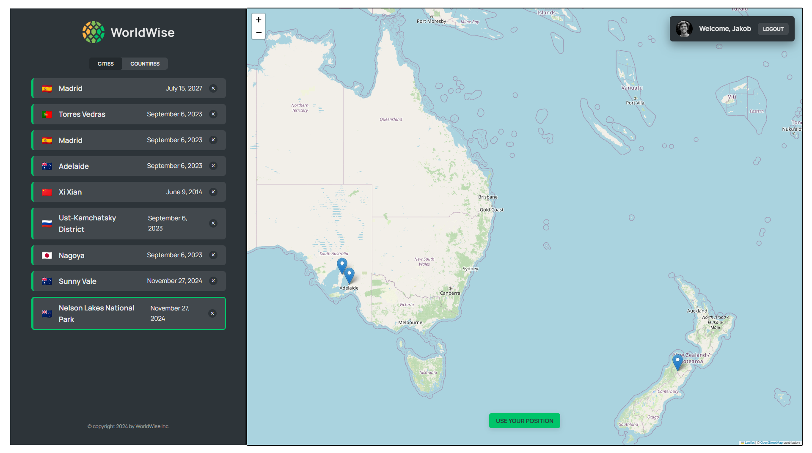

# Worldwise

Worldwise is a React application designed to provide users with the ability to both track and provide details on places they've been.
The Live version of the application uses JSON Server to access and push to a remote database to persist the details of your adventures.



[Visit Live Demo](https://world-wise-snowy.vercel.app/)

## Table of Contents

- [Installation](#installation)
- [Usage](#usage)
- [Technologies Used](#technologies-used)
- [Features](#features)
- [Project Structure](#project-structure)
- [Environment Variables](#environment-variables)
- [Scripts](#scripts)
- [Contributing](#contributing)
- [Authors](#authors)
- [Feedback](#feedback)

## Installation

1. Clone the repository:

```bash
  git clone https://github.com/your-username/WorldWise.git
  cd world-wise
```

2. Install dependencies:

```bash
npm install
```

3. Create a `.env` file in the root directory and add your database url:

```bash
   VITE_DATABASE_URL= your-database-url
```

## Usage

To start the development server, run:

```bash
npm run dev
```

To build the project for production, run:

```bash
npm run build
```

To preview the production build, run:

```bash
npm run preview
```

## Technologies Used

- React: JavaScript library for building user interfaces
- Vite: Next Generation Frontend Tooling
- Leaflet: Open-source JavaScript library for mobile-friendly interactive maps
- JSON Server: Full fake REST API for testing and prototyping [Exampe here..](https://github.com/jakolandio3/api-new-cites/blob/main/server.js)

## Features

- Click and add new markers easily
- Add, edit and delete entries to your travels
- Display Markers and flags for entries to map
- Fully function interactive map from Leaflet
- Positioning data to track your current location
- Display detailed information and entries about cities you've visited
- Listings that tracks which countries and cities you've visited
- Mock User authentication
- Responsive design for mobile and desktop

## Project Structure

- `.env/`: Environment variables
- `src/`: Source code for the application
  - `assets/`: Static assets like images and styles
  - `components/`: React components
  - `contexts/`: React context APIs
  - `hooks/`: Custom React hooks
  - `pages/`: Page components
- `public/`: Public assets
- `README.md`: Project documentation

## Environment Variables

To run this project, you will need to add the following environment variables to your .env file

- `VITE_DATABASE_URL`: The database API URL.

## Scripts

- `npm run dev:` Start the development server.
- `npm run build`: Build the project for production.
- `npm run preview`: Preview the production build.

## Contributing

Contributions are welcome! Please open an issue or submit a pull request for any changes.

## Authors

- @jakolandio3

## Feedback

If you have any feedback, please reach out to me at [jakobdouglas.dev@gmail.com](mailto:jakobdouglas.dev@gmail.com)
